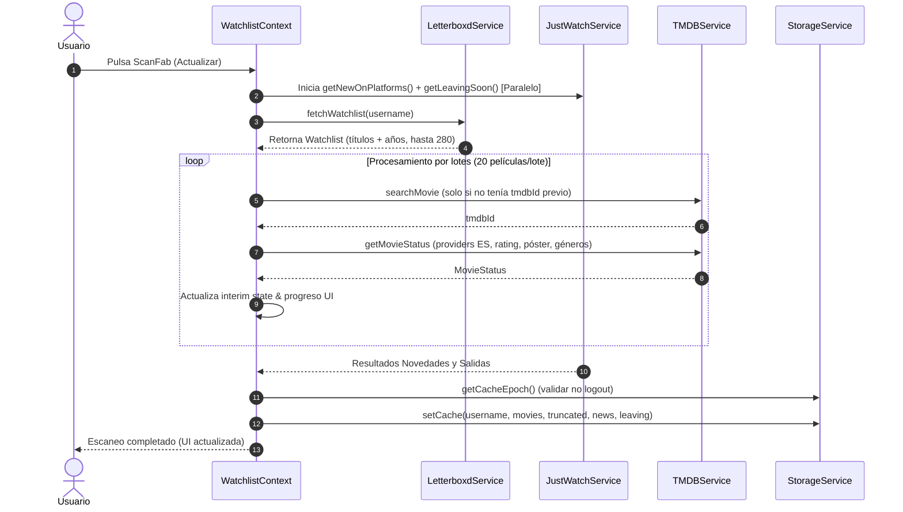

# Flujos de Ejecución y Datos - LetterWatch

Este documento detalla los flujos de ejecución críticos de la aplicación, el ciclo de vida de los datos, la interacción entre servicios externos y los mecanismos de sincronización en memoria.

---

## 1. Flujo de Arranque y Control de Acceso (Guarded Navigation)

Cuando el usuario inicia la aplicación:
1. [app/_layout.tsx](file:///home/manuqc98/reposPersonales/letterwatch/app/_layout.tsx) inicializa el tema M3, el `ThemeProvider` de React Navigation y el `SnackbarProvider`.
2. Se monta la ruta raíz `(tabs)`, ejecutando [app/(tabs)/_layout.tsx](file:///home/manuqc98/reposPersonales/letterwatch/app/(tabs)/_layout.tsx).
3. `GuardedTabs` evalúa el valor `configured` provisto por [WatchlistContext.tsx](file:///home/manuqc98/reposPersonales/letterwatch/src/context/WatchlistContext.tsx):
   * `configured === null`: Se muestra un `ActivityIndicator` a pantalla completa mientras se leen las claves `@letterwatch_username` y `@letterwatch_platforms` desde [StorageService](file:///home/manuqc98/reposPersonales/letterwatch/src/services/storage.ts).
   * `configured === false`: No hay usuario o plataformas guardadas. Se dispara `<Redirect href="/onboarding" />`.
   * `configured === true`: El usuario está configurado. Se renderiza el `Tabs` con las tres vistas principales (`news`, `watchout`, `index`).

```mermaid
flowchart TD
    Start([Inicio de App]) --> LoadStorage[StorageService: Leer Usuario y Plataformas]
    LoadStorage --> CheckConfig{¿Configurado?}
    CheckConfig -- No (null o sin datos) --> OnboardingRoute[Redirigir a /onboarding]
    CheckConfig -- Sí --> LoadCache[Cargar Caché AsyncStorage]
    LoadCache --> RenderTabs[Renderizar Tabs: Ready, News, WatchOut]
    OnboardingRoute --> SaveOnboarding[Guardar Usuario y Plataformas]
    SaveOnboarding --> ReplaceRoot[router.replace('/')]
    ReplaceRoot --> RenderTabs
```

---

## 2. Flujo de Sincronización y Escaneo Incremental

El escaneo de disponibilidad se dispara cuando el usuario presiona el botón flotante `ScanFab` o durante el primer escaneo tras el onboarding. Se ejecuta en la función `refresh()` de [WatchlistContext.tsx](file:///home/manuqc98/reposPersonales/letterwatch/src/context/WatchlistContext.tsx).

### Fases del Escaneo:

1. **Comprobación de API Key:**
   * Verifica `TMDBService.isConfigured()`. Si falta la clave de entorno `EXPO_PUBLIC_TMDB_API_KEY`, muestra un diálogo modal y aborta.
2. **Lanzamiento Asíncrono de JustWatch:**
   * Las peticiones a JustWatch (`getNewOnPlatforms` y `getLeavingSoon`) se disparan de inmediato en paralelo al escaneo de Letterboxd, evitando tiempos de espera en serie. Se capturan errores individualmente para permitir degradación suave.
3. **Scraping de Letterboxd ([LetterboxdService](file:///home/manuqc98/reposPersonales/letterwatch/src/services/letterboxd.ts)):**
   * Descarga la primera página HTML con Axios (simulando User-Agent de navegador).
   * Parsea con Cheerio los elementos `li.griditem div.react-component[data-item-slug]` extrayendo `id` (slug de la película), `title` y `year`.
   * Detecta el total de páginas. Si hay más de una, descarga concurrentemente las páginas restantes en bloques de 5 (`PAGE_CONCURRENCY`), hasta un máximo de 10 páginas (280 títulos).
4. **Sembrado y Renderizado Progresivo:**
   * Compara los títulos de la watchlist descargada con la lista existente en memoria (`previousById`).
   * Las películas que ya estaban analizadas se conservan de inmediato para que la interfaz muestre resultados sin parpadeos mientras continúa el escaneo.
5. **Cruce con TMDB por Lotes ([TMDBService](file:///home/manuqc98/reposPersonales/letterwatch/src/services/tmdb.ts)):**
   * Procesa la lista en lotes de 20 películas (`BATCH_SIZE = 20`).
   * **Búsqueda Incremental:** Si la película ya tiene `tmdbId` de escaneos anteriores, **se salta la búsqueda** por nombre. Si es nueva, consulta `/search/movie`.
   * **Detalles en Petición Única:** Con el `tmdbId`, consulta `/movie/{id}?append_to_response=watch/providers` para obtener en una sola llamada los proveedores flatrate para `ES`, la nota del público (`vote_average`), el póster y los géneros.
   * **Control de Rate Limit:** El servicio reintenta automáticamente una vez si TMDB responde con código HTTP 429 respetando el header `Retry-After`.
   * Tras procesar cada lote, se actualiza el estado `setAllMovies` y `progress`, alimentando la barra de progreso en vivo.
6. **Resolución de JustWatch y Protección de Epoch:**
   * Se espera el resultado de las promesas de JustWatch.
   * Se compara el usuario actual y el `cacheEpoch` de [StorageService](file:///home/manuqc98/reposPersonales/letterwatch/src/services/storage.ts). Si el usuario cerró sesión durante el escaneo, los resultados se descartan y no se guardan en disco.
   * Si todo es correcto, se actualiza el estado y se persiste en AsyncStorage mediante `StorageService.setCache()`.



---

## 3. Flujo de Filtrado Reactivo en Memoria

Para garantizar una experiencia fluida sin latencia de red, **el filtrado por plataformas y géneros nunca requiere re-escanear**. Se realiza de forma reactiva en memoria utilizando `useMemo` en el contexto y en las pantallas.

### A. Pantalla "Ready to watch" ([app/(tabs)/index.tsx](file:///home/manuqc98/reposPersonales/letterwatch/app/(tabs)/index.tsx))
1. Recibe `allMovies` y las plataformas activas `userPlatforms`.
2. Calcula `readyMovies` verificando si `movie.flatrateProviderIds` coincide con los IDs de TMDB de las plataformas que el usuario tiene habilitadas (`matchPlatforms`).
3. Ordena las películas disponibles mediante `compareByRating`:
   * Nota media descendente (redondeada a un decimal).
   * En caso de empate, año de estreno más reciente.
   * En caso de empate, orden alfabético por título.
4. Extrae los géneros presentes en las películas disponibles y los muestra en chips horizontales ordenados por frecuencia.
5. Aplica el filtro de selección de géneros mediante lógica de unión (OR): una película se muestra si contiene cualquiera de los géneros seleccionados por el usuario.

### B. Pantalla "News" ([app/(tabs)/news.tsx](file:///home/manuqc98/reposPersonales/letterwatch/app/(tabs)/news.tsx))
1. Lee `jwNews` (novedades recolectadas desde JustWatch).
2. Filtra dinámicamente con una ventana móvil: solo se muestran entradas cuya fecha esté dentro de los últimos 14 días respecto a la fecha actual (`Date.now()`), garantizando que la caché vieja descarte elementos vencidos sin necesidad de re-escanear.
3. Cruza por `tmdbId` con las películas de la watchlist del usuario.
4. Muestra la fecha de disponibilidad formateada (`desde DD/MM`) y un badge en la pestaña si hay novedades.

### C. Pantalla "WatchOut" ([app/(tabs)/watchout.tsx](file:///home/manuqc98/reposPersonales/letterwatch/app/(tabs)/watchout.tsx))
1. Lee `jwLeaving` (salidas próximas desde JustWatch).
2. Filtra con una ventana móvil entre el día de hoy y los próximos 30 días (`LEAVING_WINDOW_DAYS`).
3. Cruza por `tmdbId` y verifica si la película está en las plataformas activas del usuario.
4. Si la película solo está en una de las plataformas que el usuario posee, le añade el badge **"Solo aquí"** (`singlePlatform: true`) para alertar de que no tendrá otra vía para verla una vez expire.
5. Ordena por fecha de salida más inminente.

---

## 4. Flujo de Apertura de Ficha (Deep Linking)

Implementado en [src/components/MoviePosterCard.tsx](file:///home/manuqc98/reposPersonales/letterwatch/src/components/MoviePosterCard.tsx):
* Al pulsar sobre una tarjeta de película en cualquiera de las tres cuadrículas:
  1. Intenta abrir el esquema nativo de la app de Letterboxd: `letterboxd://film/${slug}` mediante `expo-linking`.
  2. Si la app nativa no está instalada o el sistema rechaza el esquema, se captura la excepción e intenta abrir en el navegador web la URL pública `https://letterboxd.com/film/${slug}/`.

---

## 5. Flujo de Ajustes y Autoguardado

Implementado en [app/settings.tsx](file:///home/manuqc98/reposPersonales/letterwatch/app/settings.tsx):
* **Autoguardado de Plataformas:** Cada conmutación de switch guarda inmediatamente la nueva configuración en `AsyncStorage` mediante `StorageService.setPlatforms`. No existe botón "Guardar".
* **Invariante Mínimo:** Se valida que el usuario no pueda desactivar la última plataforma activa (muestra un aviso en `SnackbarProvider`).
* **Borrado de Datos y Reset:**
  * Al confirmar el diálogo "Borrar todo", ejecuta `StorageService.clearAll()`.
  * Incrementa internamente `cacheEpoch`, invalidando cualquier proceso de escaneo asíncrono que estuviese en curso.
  * Ejecuta `router.dismissAll()` y `router.replace('/onboarding')` para vaciar el historial de navegación e impedir volver atrás a vistas con datos eliminados.
